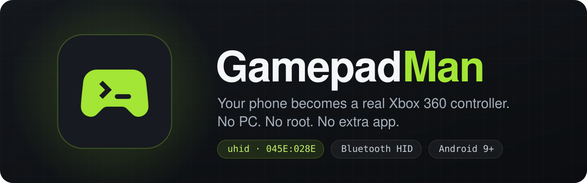
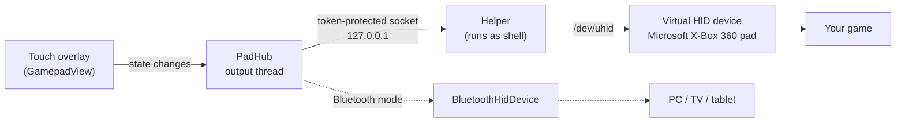

<p align="center">
  
</p>

<p align="center">
  
  
  
  
</p>

<p align="center">
  <b>GamepadMan</b> is a touch overlay that Android sees as a <b>real wired Xbox 360 controller</b>,<br>
  so you can play games that only accept gamepads. It also turns the phone into a <b>Bluetooth gamepad</b><br>
  for a PC, TV, tablet or another phone.
</p>

---

> **Why "GamepadMan"?** Same spirit as `sdkman`, `nvm` and friends: one small tool that *manages* a
> thing for you. GamepadMan manages your controllers: profiles, layouts, the virtual device and the
> helper that makes it all work. The icon is a gamepad with a `>_` prompt, because under the hood it
> drives a shell-level helper. Formerly known as **PadBridge**.

## Highlights

- **A real controller to the system:** not an accessibility hack. Games read a stock Xbox 360 pad
  through Android's own key layout (`Vendor_045e_Product_028e.kl`).
- **No PC, no root, no extra app:** a built-in ADB client pairs with the phone's own *Wireless debugging*
  once, the same technique Shizuku uses. Root and Shizuku still work as alternatives.
- **Edit the layout over the game:** drag, pinch to resize, hide controls, per-profile settings.
- **Low latency by design:** unbuffered touch dispatch, one hardware-accelerated view, a dedicated
  high-priority output thread, and zero cost while hidden.
- **Bluetooth mode:** the phone becomes a standard HID gamepad for other devices.

## How it works



| Mode | What happens | Needs |
|---|---|---|
| On-screen controller | GamepadMan starts a tiny helper as the `shell` user, which creates a virtual HID device on `/dev/uhid` named `Microsoft X-Box 360 pad` (VID 045E / PID 028E). Android loads its stock key layout, so games see a normal wired Xbox 360 pad. The overlay feeds it over a token-protected socket on 127.0.0.1. | One-time **built-in activation** (Wireless debugging), or root, or Shizuku |
| Bluetooth controller | Android 9+ `BluetoothHidDevice` API: the phone is a standard HID gamepad. | Bluetooth + "Nearby devices" permission |

Android does not let a normal app send input to another app, so a debugging-level helper is required.
GamepadMan embeds [libadb-android](https://github.com/MuntashirAkon/libadb-android) (Apache-2.0) to talk
to the phone's own ADB daemon.

## Install

Build it yourself (JDK 17–21, for example Android Studio's bundled JBR; Gradle 8.14 does not run on JDK 25):

```bash
./gradlew assembleRelease
```

```bash
adb install -r app/build/outputs/apk/release/app-release.apk
```

The release build is signed with the debug key so it can be sideloaded. Use your own keystore to publish.

## First run (one time)

1. Open GamepadMan and tap **Activate**.
2. Turn on Developer options (tap *Build number* 7 times) and **Wireless debugging** (Wi-Fi required).
3. Tap **Pair**. In Wireless debugging choose *Pair device with pairing code* and type the 6-digit code
   into GamepadMan's notification (or into the app, in split screen).
4. GamepadMan pairs, starts the helper and grants itself `WRITE_SECURE_SETTINGS`.
5. Allow *Display over other apps*, tap **Start overlay** and open your game.
   - Floating button: tap = hide/show, long-press = edit the layout over the game, drag = move it.
   - Notification: **Hide / Edit layout / Stop**. Use **Test input** to see what games receive.

**After a reboot** just tap **Start overlay**: GamepadMan turns Wireless debugging on by itself (needs Wi-Fi),
restarts the helper and (optionally) turns Wireless debugging off again. Root users can pick *Use root*;
Shizuku is still supported as a fallback. On Android 10 and older, run `adb tcpip 5555` once from a PC.

## Configuration

- **Profiles:** create, duplicate, rename, delete. Each has its own layout and settings.
- **Layout editor** (full screen or over the game): drag to move, pinch or −/+ to resize, hide/show any
  control, reset to the Xbox 360 default. Save or cancel.
- Opacity, global size, stick dead zone, fixed or floating sticks, slide between buttons, D-pad
  diagonals, vibration on press, floating button on/off.
- **Controller type:** Xbox 360 (default, most compatible), Xbox One S, or Generic HID.

Default layout (Xbox 360): LT/LB/RB/RT on top, Back/Guide/Start in the center, left stick high and
D-pad low on the left, ABXY high and right stick low on the right, plus L3/R3 buttons.

## Performance

- One hardware-accelerated view draws all controls. It redraws only when something changes, with no
  animations and no per-frame work while idle.
- Touch uses unbuffered dispatch (no vsync batching) for the lowest latency.
- Reports go out on a dedicated high-priority thread through a one-way binder call. Only changes are
  sent; stick-only updates are merged and button presses are never dropped.
- Hiding the controls removes the overlay window entirely, so there is zero cost while hidden.

## Bluetooth mode notes

- Windows, Linux and macOS see a standard HID gamepad. Use Steam Input or games with DirectInput
  support, since the phone can't present itself as an XInput device over Bluetooth.
- Android hosts map it like any Bluetooth gamepad.
- Xbox and PlayStation consoles only accept licensed controllers, so they are not supported.
- Some phone makers disable the HID Device profile (`bluetooth.profile.hid.device.enabled`).

## Self-test without Shizuku (developers)

```bash
adb shell "CLASSPATH=$(adb shell pm path com.gamepadman | cut -d: -f2) app_process /system/bin com.gamepadman.uhid.DebugMain 15"
```

This creates the virtual controller for 15 s and cycles through every button, stick, trigger and the
D-pad. Open **Test input** at the same time to watch it.

## Project layout

```
app/src/main/java/com/gamepadman/
  core/      PadState, HID descriptor + report encoder, PadHub (output thread)
  adb/       Built-in activation: ADB keys, pairing service, Activator
  helper/    HelperMain (shell-user helper) and HelperClient (token socket)
  uhid/      UhidDevice (/dev/uhid client), UhidService (Shizuku user service), ShizukuBridge, DebugMain
  bt/        BtGamepad (BluetoothHidDevice)
  layout/    PadProfile (default Xbox 360 layout), Store (profiles/settings)
  service/   PadService (foreground service, overlay windows, floating button, notification)
  ui/        GamepadView (draw + multitouch), PadPanel (editor toolbar), Compose screens
```

## Credits

- [libadb-android](https://github.com/MuntashirAkon/libadb-android) by Muntashir Al-Islam (Apache-2.0)
- [Shizuku](https://github.com/RikkaApps/Shizuku) API, supported as an optional activation method
- Icons based on [Lucide](https://lucide.dev) (ISC)
